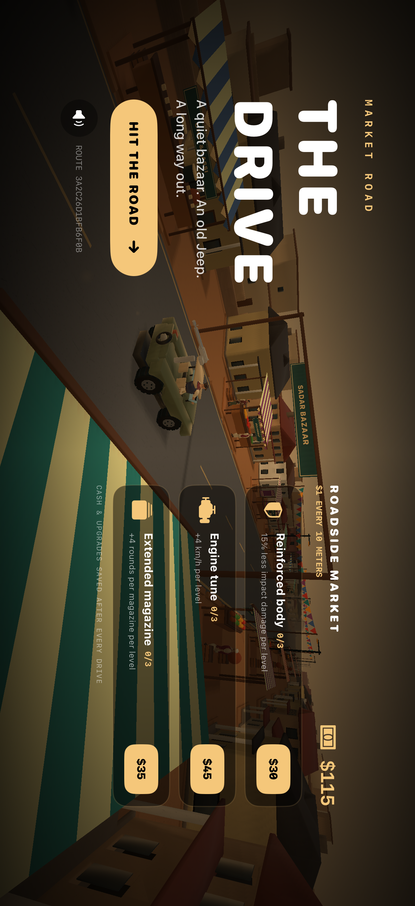
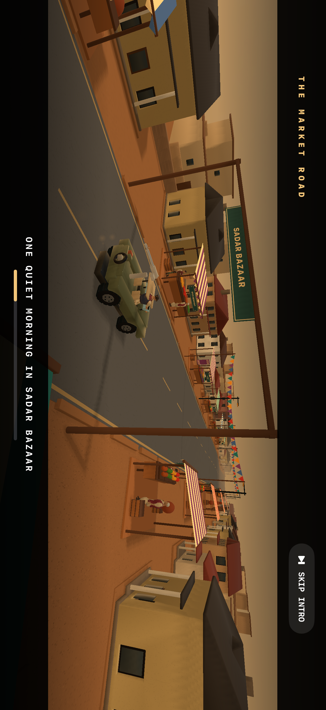
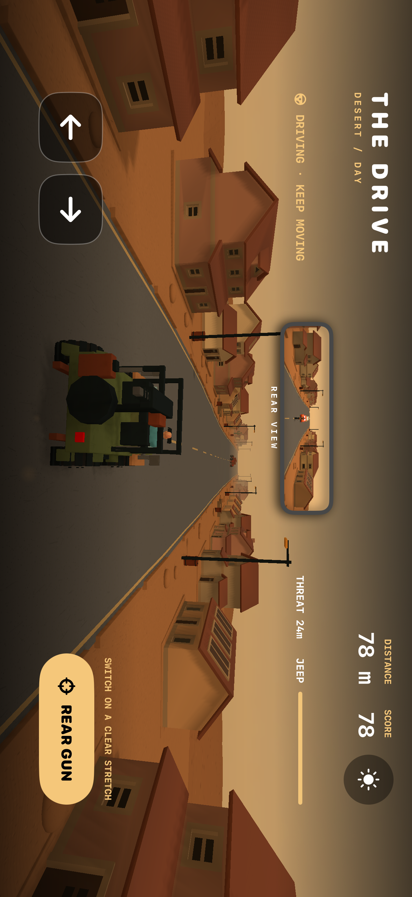
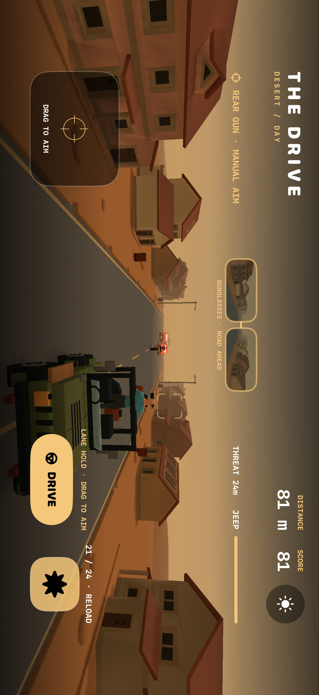
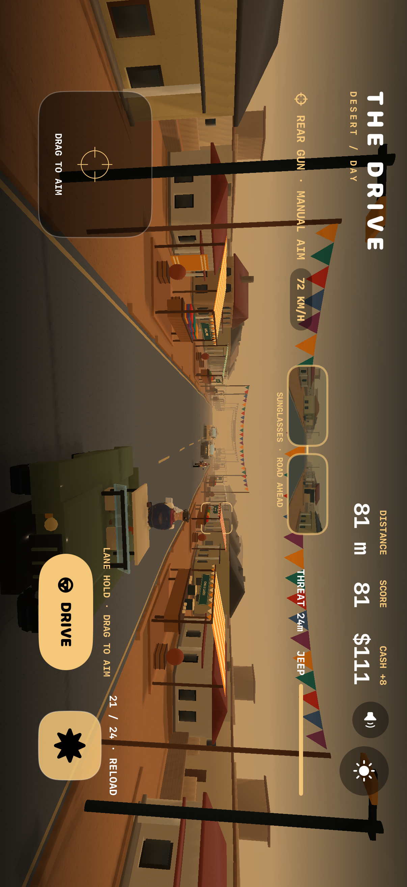
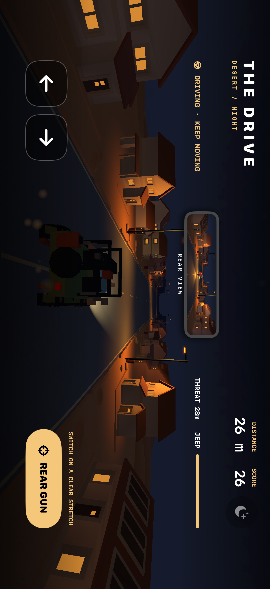
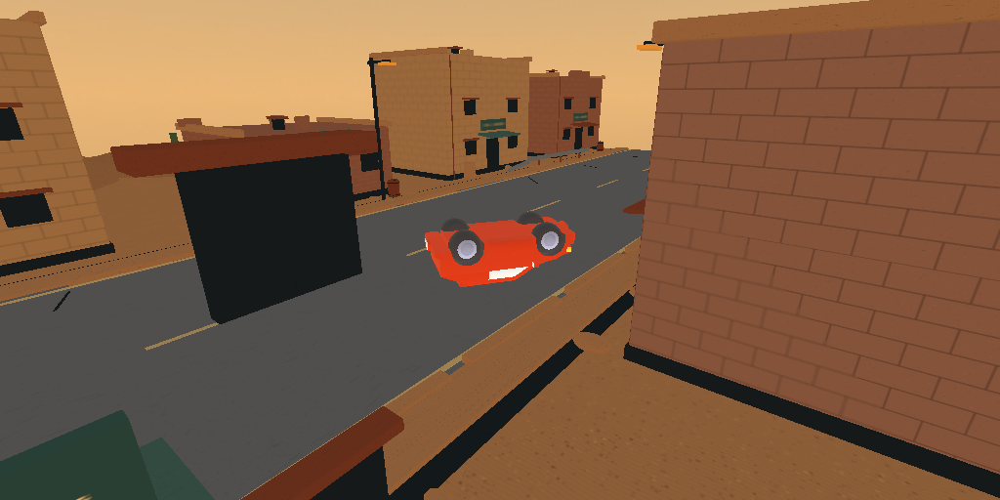

# The Drive

A native iOS 3D endless escape game built with SwiftUI and SceneKit. Play as an Indian driver escaping a fictional local gang. Drive an old jeep through a procedurally generated ruined desert town, bait pursuers into obstacles, and switch to the rear-mounted gun when the road is clear.

## Unity prototype

A separate [first Unity driving milestone](UnityDrive/README.md) now lives in `UnityDrive`, pinned to Unity 6000.3.28f1. It includes the actual Jeep and Gujarat driver, seeded endless driving, and keyboard/touch controls. The native Swift game below remains the fuller version: music, the upgrade shop, combat, day/night, and the live mirror have not yet been ported. See the Unity README for local Personal builds, tests, and the separate iOS app.

## Play

1. Open `TheDrive.xcodeproj` in Xcode.
2. Select the **TheDrive** scheme and an iPhone simulator, then press **Run**.
3. Rotate to landscape if needed. Browse the roadside market while the Jeep drives through the bazaar, then tap **HIT THE ROAD**. A seven-second opening drive hands over to gameplay automatically; **SKIP INTRO** jumps straight in.

For a physical iPhone, select your device and set your development team in the target's **Signing & Capabilities** settings before running. Requires Xcode with the iOS SDK and iOS 17 or later. No external packages or runtime downloads are required. The licensed humanoid and vehicle meshes are bundled with the app; see [asset credits](THIRD_PARTY_ASSETS.md).

## Controls

- Hold the left or right arrow to steer; release to stop steering.
- Tap **REAR GUN**. The same character climbs out of the front seat, turns around, and takes the gun over 1.1 seconds. Firing is locked during the transfer.
- In gun mode, drag the left aim pad to move the reticle and hold the right fire button. Shots follow the reticle in world space: there is no automatic targeting. Bikes juke fastest, rally cars swerve, and heavy trucks dodge slowly.
- Each magazine holds 24 rounds, with a 1.5-second reload. Tap the ammunition display to reload early. Recoil raises the reticle, so pull down to compensate.
- Tap **DRIVE** to climb back into the seat. The Jeep maintains its lane and forward speed while you use the gun; it does not automatically avoid obstacles.
- The live rear-view mirror shows approaching pursuers while driving, during day and night.
- In daylight gun mode, the driver's sunglasses provide a faint forward-road preview. This reflection is unavailable at night.
- Daylight cycles automatically through sunset, night and morning every two minutes of active play. The first night starts after roughly half a minute. Pausing freezes the clock. Tap the sun/moon button to skip to day or night; the cycle then continues.
- The seeded road has rolling hills, bumps, potholes and banked shoulders. Each tire samples the visible road surface, with filtered body pitch, roll and camera movement.
- Speed rises with actual run distance: roughly **105 km/h at 1 km**, **125 km/h at 3 km**, and **145 km/h at 6 km**, plus purchased engine upgrades. Brief seeded slowdowns ease in and out; most of the route stays fast. The speed badge shows the Jeep's actual movement, and faster hazards spawn farther ahead to retain reaction time.
- Dodge road hazards late to trick pursuers into rollovers. Bikes, rally cars, and armored vehicles have different handling and durability.
- Avoid crossing pedestrians and wreckage. If the pursuers catch you or the jeep is destroyed, the run ends.
- Tap **TRY ANOTHER ROUTE** to start again with a new route seed.
- Earn **$1 for every 10 meters** of actual driving. Cash is banked as you go and survives retries and app relaunches; watching the title or opening does not earn money.
- Spend cash in the roadside market before a run: **Reinforced body** reduces impact damage by 15% per level (first level $30), **Engine tune** adds 4 km/h per level (first level $45), and **Extended magazine** adds four rounds per level (first level $35). Each upgrade has three levels; subsequent levels cost two and three times the starting price. Purchases apply to the next run.
- The two selected Suno songs are bundled for offline playback. The route seed also chooses 1-, 2-, 4-, and 8-bar cuts, alternating songs with short equal-power crossfades. Audio runs on its own sample clock, continues across the cinematic handover, and pauses when the app is inactive. Tap the speaker button to mute; the preference is saved.

## Structure

- `TheDrive/GameModel.swift`: game state, movement, pursuit, shooting, collisions, and endless recycling.
- `TheDrive/WorldBuilder.swift`: imported houses and vehicles, seeded environment districts, road meshes, materials, and lighting.
- `TheDrive/DayCycle.swift`: continuous solar phases and daylight.
- `TheDrive/RoadSurface.swift`: seeded surface heights, four-wheel contact fitting, and suspension filtering.
- `TheDrive/GameView.swift`: touch controls, HUD, start/retry screens, and SceneKit host.
- `TheDrive/LaunchView.swift`, `LaunchScreen.storyboard`, and `GameArt.xcassets`: native launch art, loading view, and app icon.
- `TheDrive/GujaratCharacter.swift`: the supplied driver, explorer, and grandpa, with shared PBR atlases and their original 22-bone skins.
- `TheDrive/DrivingPace.swift`: distance-based acceleration, deterministic slowdowns, and high-speed hazard lead.
- `TheDrive/Marketplace.swift`: seeded bazaar stalls, produce, signs, pennants, and animated vendors.
- `TheDrive/Progression.swift`: saved wallet, upgrade prices, and purchase handling.
- `TheDrive/Soundtrack.swift`: deterministic bar planner, PCM crossfades, and queued offline audio playback.
- `TheDrive/TheDriveApp.swift`: app entry point.

The prototype uses procedural geometry and arcade movement rather than a full vehicle physics simulation. All game-state updates run on the main actor.

To build from Terminal without device signing:

```sh
xcodebuild -project TheDrive.xcodeproj -scheme TheDrive -sdk iphonesimulator -configuration Debug -derivedDataPath build CODE_SIGNING_ALLOWED=NO build
```

Run the simulation tests on an installed simulator (replace the device name if needed):

```sh
xcodebuild -project TheDrive.xcodeproj -scheme TheDrive -destination 'platform=iOS Simulator,name=iPhone 18 Pro' CODE_SIGNING_ALLOWED=NO test
```

Tests cover pause/resume timing, rear-gun combat and scoring, contiguous recycled road tiles, reproducible route geometry, day/night lights, and restart state.

## Validation

Built and launched on the iPhone 18 Pro simulator with Xcode 27.2 / iOS 27.2. Simulation, projection, progression, and audio tests cover manual hits and misses, evasive steering, transfers, reload timing, paused state, the imported skin rig, camera projection, procedural generation, and bounded resources over repeated seeded runs, crash trajectories, paused rollovers, delayed player game-over, the imported cars’ steering wheels, automatic daylight phases, terrain mesh alignment and seamless chunk boundaries. Four UI smoke tests cover the marketplace opening, music controls, live mirror, manual aim/fire/seat return, and night behavior. Screenshots are retained in the Xcode test result attachments.

Opening and progression tests verify automatic and skipped handovers, paused cinematic clocks, safe autonomous previews, cash persistence, purchase limits, and applied engine/magazine upgrades. Audio tests decode the actual bundled files, check seeded whole-bar continuity over 512 pieces, and verify crossfades against source PCM. A 128-second offline render through the live mixer's PCM renderer contained no silent 10-millisecond windows and stayed below full scale.

The latest simulator verification passed 59 unit tests and four UI tests, including actual AVAudioEngine startup, pause/resume, mute/unmute, stop, distance-based pace changes, and the three supplied character rigs. Character checks evaluate actual skinned vertices through seat/gun/return poses, verify hands against the controls, and sample authored atlas colors to catch UV orientation regressions. The final run has no scenery shader compilation errors.

The visuals use procedural textured geometry, physically based paint and metal, day/night environment reflections, detailed treads and vehicle fittings, transparent windscreens, suspension bounce, and bounded dust particles. Shared 512-pixel surface textures are generated once and cached. A triple-buffered Metal pass renders the 384×112 mirror and sunglass view at up to 20 fps (12 under thermal pressure), then presents and samples those GPU textures directly. The game loop no longer takes UIImage snapshots or waits for GPU-to-CPU readback. The main view and simulation target 60 fps. Scenery is batched by shared materials, wheel geometry and surface images are cached, and bullets reuse a fixed pool of twelve tracer nodes.

Rally cars, SUVs, and the pursuit bike are original surfaced models with separate wheels, steering, filtered body lean, and integrated tire rotation. Vehicles that hit roadblocks or lunge onto the broken shoulder can launch, tumble, bounce, and slide into a wreck. Crash motion uses simulation time, pauses correctly, and caps active wrecks at eight; a fatal Jeep impact plays its rollover before showing retry. The route remains endless.

Six surfaced house models, with porches, chimneys, tiled roofs, damaged variants, fences and terrain-supported foundations, line the road. Seeded sections vary between village streets, ruined compounds, sparse outskirts and open desert. Window emission, street lamps and headlights fade with the solar cycle; sky blending uses at most 33 small cached maps with one unchanged reflection-lighting map.

The supplied Gujarat Desert Adventure character pack provides the curly-haired driver, braided explorer, and clean-shaven grandpa. Their original clothing, hair, PBR textiles, and 22-bone rigs are retained in mobile meshes; they replace the previous generic cast. The driver uses the steering wheel and rear-gun handles, and the explorer and grandpa populate the bazaar and crossing pedestrians. Source goggles provide the daytime road reflection. The previous Quaternius mesh remains a fallback. The player jeep, pursuit bike, rally car, SUV, and the town are original surfaced models with beveled walls, window openings, and separate glass.

The icon and launch illustration were generated for the game's Gujarat desert theme. Exact prompts and asset paths are retained in `Tools/ArtDirection.txt`. Launch video confirms the loading artwork and native progress indicator appear before the marketplace. The signed Release build was installed on the connected iPhone 16; opening it remotely requires the phone to be unlocked. Sustained frame rate and thermal behavior still need a longer play session on the phone.

To rebuild the mobile characters from the supplied pack (requires Blender and Python with NumPy):

```sh
python3 Tools/import_gujarat_characters.py ~/Downloads/Gujarat_Desert_Characters_Pack.zip
```

Only optimized geometry and 1024-pixel PBR atlases are bundled. Source credits, source hashes, optimization statistics, and the original pack README are retained under `TheDrive/Assets/Gujarat`.














