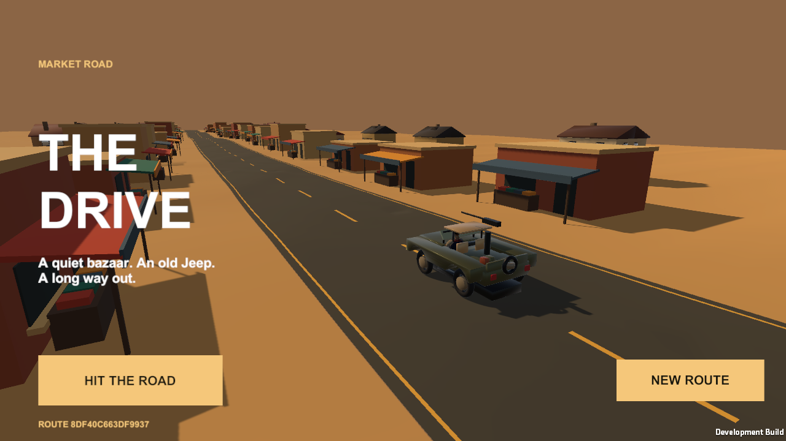
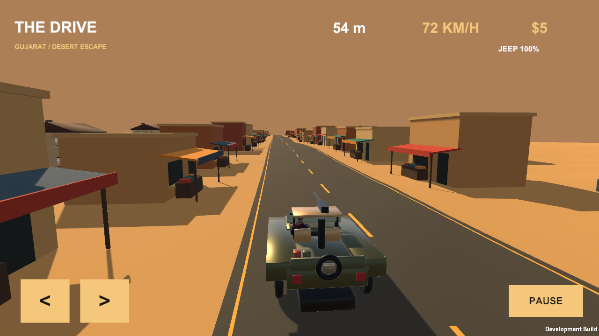

# The Drive — first Unity driving milestone

This is a separate Unity prototype alongside the [native Swift game](../README.md). It establishes the driving foundation: the actual sculpted Jeep and seated Gujarat driver, a seeded endless road, modeled houses and roadside shops, wheel animation, road-following suspension, distance-based pace, steering, barriers, health, and pause/resume. It does not yet have full Swift feature parity.

The soundtrack, purchasable upgrades and interactive shop, pursuit/combat, rear-gun gameplay, day/night cycle, and live mirror remain in the native Swift version and have not been ported. The Unity cash display counts the current run; it is not the native saved wallet or upgrade system.

## Open and play

Use the pinned **Unity 6000.3.28f1** Editor with its iOS Build Support module for iPhone exports. This project uses the built-in render pipeline and locally installed Unity Personal. Preparation, testing, and builds run locally; no cloud build service, paid asset purchase, or Unity subscription purchase is part of this workflow.

1. In Unity Hub, add and open this `UnityDrive` folder, rather than the repository root.
2. Allow the initial import to complete. Select **The Drive → Prepare Project** to create the scene and apply project settings.
3. Open `Assets/Scenes/TheDrive.unity` and press **Play**.
4. Select **HIT THE ROAD**. Hold **Left/Right arrows** or **A/D** to steer on a keyboard. On touch screens, hold the on-screen **< / >** buttons. Forward speed is automatic.
5. Select **PAUSE**, or press **Escape** during driving; select **RESUME** to continue. **NEW ROUTE** on the title/result screen starts a fresh seeded route.

The iOS export is a separate app, **The Drive Unity**, with bundle identifier `com.vihaanshah.thedrive.unity`; it does not replace the native Swift app. The signed Release app built successfully in Xcode and passed code-signature verification. Its development profile includes the paired iPhone. Installation is pending: CoreDevice reported that the phone was unreachable. Connect and unlock the phone before installing or running from Xcode.

## Assets

`Resources/Drive` contains the existing optimized game assets, rather than the large source character pack. The Gujarat driver, explorer, and grandpa retain their source clothing, PBR atlases, 22-bone skeletons, skin weights, and meshes. Character/vehicle geometry is loaded and cached at runtime. A small Standard surface shader retains the Jeep and scenery's linear vertex colors; character materials use the built-in Standard shader.

To regenerate staged resources from the native game's checked-in assets, run from the repository root:

```sh
python3 -m venv .venv-unity-assets
.venv-unity-assets/bin/python -m pip install Pillow
.venv-unity-assets/bin/python Tools/prepare_unity_assets.py
```

The script copies optimized buffers and art, and repacks metallic/roughness textures for Standard. It does not re-decimate characters. JSON and binary resources have distinct `*-manifest` and `*-buffer` keys because Unity resource lookups omit extensions. The coordinate conversion mirrors X and reverses triangle winding; vehicles face game forward, **−Z**. Unity uses the authored bottom-origin UVs without SceneKit's V flip. Credits and provenance are retained beside the staged assets; see also [third-party asset credits](../THIRD_PARTY_ASSETS.md).

## Local command-line workflow

Run these examples from the repository root with the Unity Editor closed. Change the Editor path if Unity Hub installed it elsewhere. Activate the local Personal license through Unity Hub before batch execution.

```sh
UNITY_EDITOR="/Applications/Unity/Hub/Editor/6000.3.28f1/Unity.app/Contents/MacOS/Unity"
UNITY_PROJECT="$PWD/UnityDrive"
mkdir -p "$UNITY_PROJECT/Logs" "$UNITY_PROJECT/TestResults"
```

Prepare the scene/settings:

```sh
"$UNITY_EDITOR" -batchmode -nographics -quit -projectPath "$UNITY_PROJECT" \
  -executeMethod TheDrive.UnityGame.Editor.DriveBuild.Prepare \
  -logFile "$UNITY_PROJECT/Logs/prepare.log"
```

Run EditMode checks:

```sh
"$UNITY_EDITOR" -batchmode -nographics -projectPath "$UNITY_PROJECT" \
  -runTests -testPlatform EditMode \
  -testResults "$UNITY_PROJECT/TestResults/EditMode.xml" \
  -logFile "$UNITY_PROJECT/Logs/tests.log"
```

Build the local Mac preview:

```sh
"$UNITY_EDITOR" -batchmode -nographics -quit -projectPath "$UNITY_PROJECT" \
  -buildTarget StandaloneOSX \
  -executeMethod TheDrive.UnityGame.Editor.DriveBuild.BuildMac \
  -logFile "$UNITY_PROJECT/Logs/build-mac.log"
open "$UNITY_PROJECT/Builds/TheDriveUnity.app"
```

The development preview also supports the automated runtime smoke check, which writes screenshots and `result.json`, then exits. Keep the preview in the foreground; ordinary play intentionally pauses in the background:

```sh
open -n -W "$UNITY_PROJECT/Builds/TheDriveUnity.app" --args \
  -driveSmoke "$UNITY_PROJECT/TestResults/Smoke" \
  -logFile "$UNITY_PROJECT/Logs/runtime-smoke.log"
```

Export the separate iPhone app to Xcode:

```sh
"$UNITY_EDITOR" -batchmode -nographics -quit -projectPath "$UNITY_PROJECT" \
  -buildTarget iOS \
  -executeMethod TheDrive.UnityGame.Editor.DriveBuild.BuildIOS \
  -logFile "$UNITY_PROJECT/Logs/build-ios.log"
```

The default export directory is `UnityDrive/Builds/iOS`; `THE_DRIVE_UNITY_IOS_OUTPUT` overrides it. Open the exported Xcode project, select your own signing team and connected iPhone, then build/run. The local build menu exposes the same preparation, Mac preview, and iPhone export operations.

## Validation and limits

The current **11 EditMode checks passed** in Unity 6000.3.28f1. They cover source mesh/resource identity, all three actual 22-bone characters, finite CPU-baked posed skins, valid triangle indices, PBR textures and sampled atlas UVs, wheel pivots, seeded road/pace behavior, touch cancellation, and stable pooled world objects/meshes after 10,000 frames and resets.

The Mac player runtime smoke check passed with **zero errors**. It exercises startup, actual Jeep/driver rendering, entering a run, increasing distance, steering input, pause/resume, and touch reacquisition. Screenshots were inspected for the title and driving HUD. The separate iPhone Release app compiled and its signature verified; physical installation and sustained mobile frame rate/thermal behavior still need device verification.

The existing themed app icon and launch illustration are reused for iPhone. The launch screen includes iOS's loading indicator.




